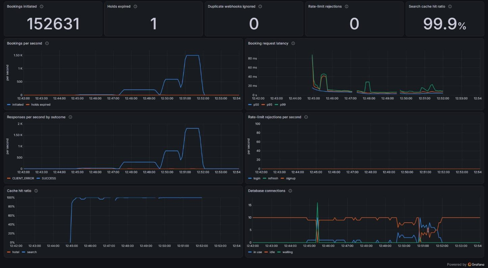

# RoomKeeper

A hotel booking backend in Java 25 and Spring Boot, built test-first. It focuses on the problems real booking systems get wrong: selling the last room twice, charging or refunding a payment twice, holds that never release, and side effects lost or sent twice.

> Work in progress. See the [roadmap](docs/roadmap.md) for where things stand.

## Docs

- [Project design](docs/Hotel%20Booking%20Backend%20Project%20Design.md): goals, schema, API, booking lifecycle, and the hard problems
- [Roadmap](docs/roadmap.md): the build plan broken into tasks
- [Query plans](docs/query-plans.md): `EXPLAIN ANALYZE` of hotel search over a million inventory rows (about 1 ms) and the indexes it uses
- [Load test](docs/load-test.md): k6 against the booking endpoint, up to about 1,800 requests a second, and what the dashboard showed

## The hard problems

These four are why the project exists. For each: what goes wrong, what RoomKeeper does, what it doesn't do and why, and the tests that prove it.

### Selling the last room twice

**What goes wrong.** Two guests ask for the last room at the same moment. Both read one room free, both take it, and the hotel has sold one room twice.

**What RoomKeeper does.** Holding rooms locks the stay's inventory rows (`SELECT ... FOR UPDATE`, one row per night), always in date order, then checks and updates them in the same transaction. The second guest waits for the first, reads the true count, and gets 409 `sold-out`. Every writer of those rows (holds, hold expiry, payments, cancellation, inventory admin, room totals) locks nights in the same date order, so overlapping writes queue instead of deadlocking. Behind all of it, a check constraint (`inventory_not_oversold`: booked plus held never exceeds the total) refuses an oversell even from plain SQL.

**Not done, and why.** Optimistic locking (a version column, retry on conflict) suits rare conflicts, but here they cluster on exactly the last few rooms, where it would retry the most. A Redis lock per room would put the rule in a store that isn't the source of truth: a lock lost in a failover lets two guests through, while a row lock lives and dies with the transaction that needs it.

**Proved by**
- [`LastRoomConcurrencyIT`](src/test/java/com/roomkeeper/booking/LastRoomConcurrencyIT.java): 50 guests ask for the last room at once; exactly one gets it, the other 49 get `sold-out`.
- [`BookingRacesIT`](src/test/java/com/roomkeeper/booking/BookingRacesIT.java): guests book while the manager changes the same nights' totals and surge; nothing deadlocks or oversells.
- [`InventoryConstraintsIT`](src/test/java/com/roomkeeper/inventory/InventoryConstraintsIT.java): the database refuses an oversell written straight in SQL.
- The [load test](docs/load-test.md) races 50 guests for the last 5 rooms alongside up to 1,500 other holds a second: exactly 5 win, every run.

### Charging or refunding twice

**What goes wrong.** Networks retry and guests double-click, so "hold these rooms" or "start paying" can arrive twice. Stripe delivers each webhook at least once, sometimes two copies at the same moment. Handled naively, that's two holds, two checkout sessions, a booking confirmed twice, or a payment refunded twice.

**What RoomKeeper does.**
- Requests that create something carry an `Idempotency-Key`. The first claims the key in Redis (`SET NX`) and stores its response; a retry gets that response back, marked `Idempotent-Replayed: true`. If Redis is down these requests answer 503: refusing is better than risking a second payment.
- A webhook records its event id in `processed_webhook_events` in the same Postgres transaction as the change it makes. A redelivery finds the id and changes nothing; two copies arriving together queue on the primary key, and the second changes nothing.
- Every call to Stripe that moves money carries an idempotency key of its own (one per payment for refunding a late payment, one per booking for a cancellation's refund), so a retry is a no-op on Stripe's side too.

**Not done, and why.** Webhook dedupe in Redis: the "already applied" mark would commit separately from the change it marks, so a crash between the two either loses the event or applies it twice. Disabling the button in the client: it helps, but the retry that matters often comes from the network, not the guest.

**Proved by**
- [`InitIdempotencyIT`](src/test/java/com/roomkeeper/booking/InitIdempotencyIT.java): a retried hold with the same key returns the original booking, not a second hold.
- [`PaymentStartIT`](src/test/java/com/roomkeeper/payment/PaymentStartIT.java): asking to pay again returns the open session, never a second.
- [`PaymentWebhookIT`](src/test/java/com/roomkeeper/payment/PaymentWebhookIT.java): the same webhook twice confirms once and writes one outbox row; deliveries in flight together confirm once.
- [`CancellationIT`](src/test/java/com/roomkeeper/payment/CancellationIT.java): cancelling twice, or the refund event arriving twice, refunds once.

### Holds that never release

**What goes wrong.** A guest holds the last room, then closes the tab. If nothing gives the room back, it's off sale for good. And Stripe's checkout page stays open longer than the hold, so a guest can pay for rooms that already went back on sale, maybe to someone else.

**What RoomKeeper does.** A hold has an expiry time (10 minutes), and reads show it as `EXPIRED` the moment that passes. A job runs every minute and gives the rooms back, each hold in its own transaction, re-checked under the booking's lock so a payment that just landed wins. Every instance schedules it, but only the one holding the Redis lease `lock:hold-expiry` runs it. If the guest was paying, the job also closes their Stripe session. A payment that still arrives late re-checks the stay as a new booking would: if the rooms are still free, it books them at the price paid; if not, it refunds in full, calling Stripe outside the transaction so no locks are held while it waits. Either way the booking ends confirmed or refunded, never stuck. Time comes from an injected `Clock`, so tests move it instead of sleeping.

**Not done, and why.** Redis key expiry with keyspace notifications: they're fire-and-forget, so one missed while the app restarts would leave the rooms held for good, and the inventory lives in Postgres anyway. Releasing only when someone reads the booking: nobody reads an abandoned hold again, so its rooms would stay off sale.

**Proved by**
- [`HoldExpiryIT`](src/test/java/com/roomkeeper/booking/HoldExpiryIT.java): a hold gives its rooms back at 10 minutes, not a second sooner, with the clock moved instead of waited on.
- [`HoldReleaseIT`](src/test/java/com/roomkeeper/booking/HoldReleaseIT.java): what the job releases and what it leaves alone; cheapest prices and cached searches follow.
- [`HoldExpiryLockIT`](src/test/java/com/roomkeeper/booking/HoldExpiryLockIT.java): every instance schedules the job; only the lock holder runs it.
- [`LateWebhookIT`](src/test/java/com/roomkeeper/payment/LateWebhookIT.java): a payment after the hold ran out is confirmed if the room is still free and refunded once if not, even with deliveries racing or Stripe failing the first refund.

After the load test, one run of the job released all 150,000-odd abandoned holds, at 200 to 480 a second whenever the laptop's Docker VM wasn't stalled ([details](docs/load-test.md#after-the-runs-releasing-152425-abandoned-holds)).

### Side effects lost or sent twice

**What goes wrong.** Send the confirmation email inside the booking transaction, and a rollback after sending tells the guest about a booking that doesn't exist. Send it after the commit, and a crash in between loses it. The same goes for the refund a cancellation owes.

**What RoomKeeper does.** A transactional outbox. A change writes its side effects as rows in `outbox_events` inside its own transaction (the writer refuses to run outside one), so they commit or roll back together. A publisher runs every 5 seconds under `lock:outbox` and takes each waiting event in its own transaction (`FOR UPDATE SKIP LOCKED`, so overlapping runs split the queue), hands it to its consumers, and marks it published. Delivery is at least once, so every consumer tolerates a repeat: an email's idempotency key is its event's id, and a cancellation's refund uses one Stripe key per booking with the amount fixed when the guest cancelled. An event that fails 10 times is parked with its last error rather than retried forever.

**Not done, and why.** An after-commit event listener: simple, but the event lives only in memory, so a crash right after the commit loses it. A message broker (Kafka, Redis Streams): publishing to one reliably from a database transaction needs an outbox in front of it anyway, and at this scale polling one table is enough (publishing to Redis Streams is a stretch goal). Retrying forever: one poison event would be retried, and logged, for good.

**Proved by**
- [`OutboxWriterIT`](src/test/java/com/roomkeeper/outbox/OutboxWriterIT.java): an outbox event commits or rolls back with the change that wrote it.
- [`OutboxPublisherIT`](src/test/java/com/roomkeeper/outbox/OutboxPublisherIT.java): each event goes out at least once, a duplicate sends one email, and an event that keeps failing is parked.
- [`CancellationIT`](src/test/java/com/roomkeeper/payment/CancellationIT.java): the refund is made exactly once, even when Stripe fails the first attempt and the event is handed over again.

### Smaller decisions

| Decision | Why | Proved by |
| --- | --- | --- |
| Cached searches live 60 seconds under a per-city version; any inventory change that changes what search shows bumps it | Stale availability is the bug guests would notice; a bump is one `INCR`, not a scan for old keys | [`SearchCacheEvictionIT`](src/test/java/com/roomkeeper/search/SearchCacheEvictionIT.java) |
| Cached hotel info lives 10 minutes under a per-hotel version, read before the database and bumped after a change commits, rather than being deleted | A guest's read that loaded the old details just before the change caches them under the old version, which nothing reads; deleted instead, its late write would serve them for the full 10 minutes | [`HotelInfoCacheRaceIT`](src/test/java/com/roomkeeper/search/HotelInfoCacheRaceIT.java) |
| With Redis down, caches and rate limits fail open, idempotency keys fail closed (503), and refresh asks the user to log in again | Postgres decides what's true: losing Redis costs speed and some protection, never a booking or a second charge | [`CacheFailOpenTest`](src/test/java/com/roomkeeper/search/CacheFailOpenTest.java), [`RateLimitFilterTest`](src/test/java/com/roomkeeper/common/ratelimit/RateLimitFilterTest.java), [`IdempotencyFilterTest`](src/test/java/com/roomkeeper/common/idempotency/IdempotencyFilterTest.java), [`AuthServiceRedisDownTest`](src/test/java/com/roomkeeper/auth/AuthServiceRedisDownTest.java) |
| Every wait on a store is bounded: Redis commands 1 s, a free database connection 3 s, a database read 5 s (the drivers' defaults are a minute, 30 s and forever). A lost or busy database answers 503 with `Retry-After` | A Redis or Postgres that stops answering, as in a network partition, would otherwise hold every request and run the server out of threads; this way search, hotel info and login keep working with Redis gone, and requests fail fast to be retried when Postgres is | [`OutageIT`](src/test/java/com/roomkeeper/common/OutageIT.java), [`LostConnectionTest`](src/test/java/com/roomkeeper/common/error/LostConnectionTest.java) |
| After a booking, its hotel's cheapest prices are recomputed in the background, with at most one recompute waiting per hotel | A burst of bookings at one hotel queues one recompute, not one per booking; the load test found the per-booking queue dropping 51,501 | [`RepricingBurstIT`](src/test/java/com/roomkeeper/search/RepricingBurstIT.java), [`PendingRecomputesTest`](src/test/java/com/roomkeeper/search/PendingRecomputesTest.java) |
| Jobs (hold expiry, outbox, inventory roll) run on whichever instance holds a Redis lease | Every instance can schedule them; one runs each time, and a crashed holder's lease runs out | [`JobLocksIT`](src/test/java/com/roomkeeper/common/JobLocksIT.java) |
| Login, signup, refresh and public search are rate limited per client IP | Password guessing and bulk signups get slow, and nobody can sweep search or dodge its cache to load Postgres | [`LoginRateLimitIT`](src/test/java/com/roomkeeper/common/ratelimit/LoginRateLimitIT.java), [`AuthRateLimitIT`](src/test/java/com/roomkeeper/common/ratelimit/AuthRateLimitIT.java), [`SearchRateLimitIT`](src/test/java/com/roomkeeper/common/ratelimit/SearchRateLimitIT.java) |
| Behind a reverse proxy, the client IP is the last address a proxy in `TRUSTED_PROXIES` added to `X-Forwarded-For`; from anyone else the header is ignored. None are trusted by default | Rate limits count real clients, and nobody can claim a new address per request to dodge them (Tomcat on its own trusts every private-network address) | [`ForwardedClientIpIT`](src/test/java/com/roomkeeper/common/ratelimit/ForwardedClientIpIT.java) |
| Redis evicts the keys closest to expiring when full (`maxmemory` 256 MB, `volatile-ttl`) | Cached searches and rate-limit buckets go first; refresh tokens and idempotency keys, which live for days and hours, stay. Without a policy a full Redis refuses writes | [`RedisEvictionIT`](src/test/java/com/roomkeeper/common/RedisEvictionIT.java) |
| Signup answers the same for a registered email, and emails its owner instead | Signup can't reveal who has an account | [`SignupIT`](src/test/java/com/roomkeeper/auth/SignupIT.java) |
| Refresh tokens are opaque, stored as a hash in Redis, and single use; a used one coming back ends its whole session, the newest token included | Rotation and logout really revoke them, and a stolen copy is caught when either the thief or the user refreshes after the other. Two refreshes racing with one token look the same, so that session ends too | [`RefreshTokenIT`](src/test/java/com/roomkeeper/auth/RefreshTokenIT.java) |
| The cancellation policy is plain domain code: all back with 48 hours' notice, half with less, nothing once the stay has begun (2 PM hotel time) | Easy to test across time zones and clock changes | [`CancellationPolicyTest`](src/test/java/com/roomkeeper/booking/CancellationPolicyTest.java) |
| A hotel taken off sale honours its paid bookings | Off sale may be a pause; guests can still cancel under the policy | [`HotelDeactivationIT`](src/test/java/com/roomkeeper/hotel/HotelDeactivationIT.java), [`CancellationIT`](src/test/java/com/roomkeeper/payment/CancellationIT.java) |
| Business metrics count after commit | A change that rolls back isn't counted | [`BusinessMetricsTest`](src/test/java/com/roomkeeper/common/metrics/BusinessMetricsTest.java) |
| Actuator answers only on a private port | Metrics and health details aren't public | [`ActuatorLockdownIT`](src/test/java/com/roomkeeper/ActuatorLockdownIT.java) |

## Running locally

Requires JDK 25 and Docker.

```bash
# Once: .env (gitignored) with a random JWT secret and passwords; prints only names
scripts/init-env.sh

# Whole stack from source: app (prod profile), Postgres 18, Redis 8
docker compose up -d --build --wait
scripts/smoke.sh                      # smoke checks over HTTP
scripts/scan-image.sh                 # Grype vulnerability scan of the image, as in CI

# Or run only the services and start the app yourself (local profile)
docker compose up -d postgres redis
./mvnw spring-boot:run
```

The app listens on port 8080, with health probes at `/livez` and `/readyz` (ready while Postgres answers). Actuator (health details, info, and Prometheus metrics) answers only on port 8081, which Compose doesn't publish: on 8080, `/actuator/*` is 404. Postgres and Redis are published on 15432 and 16379, on localhost only, so they don't collide with native installs and aren't reachable from the network. Override with `APP_PORT`, `POSTGRES_PORT`, and `REDIS_PORT`.

## Using the API

Swagger UI is the client: open http://localhost:8080 (it redirects there) or http://localhost:8080/swagger-ui.html. In the `prod` profile the API docs and Swagger UI are off unless `API_DOCS_ENABLED=true`, and then `/`, `/v3/api-docs` and `/swagger-ui.html` are 404; Compose turns them on, since Swagger UI is the local client.

1. `POST /api/v1/auth/signup` with an email, a password (at least 8 characters, at most 72 bytes: BCrypt's limit), and a name. Add `"role": "HOTEL_MANAGER"` to manage hotels. The answer is always 202 with the same message, even for an email that's already registered, so signup can't be used to find out who has an account. A new account can log in at once and gets a welcome email; if the email was already registered, nothing changes and its owner is emailed that someone tried to sign up with it.
2. `POST /api/v1/auth/login` returns an `accessToken` (valid 15 minutes) and a `refreshToken` (valid 7 days, single use).
3. Click **Authorize** and paste the access token. Routes with a lock icon now work.
4. When the access token expires, `POST /api/v1/auth/refresh` with the refresh token returns a new pair; keep only the new refresh token, since sending an old one again ends the session and means logging in again. `POST /api/v1/auth/logout` ends the session.

Per client IP, login allows 10 attempts a minute, signup 20 an hour, and refresh 30 a minute, and search (`GET /api/v1/hotels/search`) 300 a minute (per address forwarded by a proxy in `TRUSTED_PROXIES`, an IP regex, when there is one: see Configuration profiles); past that the API answers 429 with a `Retry-After` header. Every error is an RFC 9457 problem detail (`application/problem+json`); match on its `type`, such as `urn:roomkeeper:problem:invalid-credentials`.

### Finding a hotel (no login needed)

- `GET /api/v1/hotels/search?city=Goa&checkIn=2026-12-24&checkOut=2026-12-27` lists hotels with a room type free for every night of the stay, cheapest first. Optional: `rooms` (default 1), `page` (from 0), and `size` (default 20, at most 50). Stays are up to 30 nights. Each hotel shows `fromPricePerNight`, the cheapest nightly price of any bookable room during the stay.
- `GET /api/v1/hotels/{id}/info` shows an active hotel's details and room types.

Prices come from a rule chain applied per night: base price, then the night's surge factor, 20% more once a room type is 80% booked or held, 15% more on Friday and Saturday nights, and 25% more on configured holidays (`roomkeeper.pricing` in `application.yaml`). Search shows each hotel's cheapest price per night from `hotel_min_price`; when a deploy changes these settings (or `PricingProperties.RULES_VERSION`, bumped when a rule's code changes), an instance starting with the new settings re-prices every hotel on sale in the background ([`PricingSettingsRepricingIT`](src/test/java/com/roomkeeper/search/PricingSettingsRepricingIT.java)).

### Setting up a hotel (as a `HOTEL_MANAGER`)

Anyone can sign up as a manager, but a hotel only goes on sale after an admin approves it. Nobody can sign up as an admin: the first admin account is created at startup from `ADMIN_EMAIL` and `ADMIN_PASSWORD` (`admin@roomkeeper.local`, with the password from `.env` in Compose; `local-admin-password` when the local profile runs without one).

1. `POST /api/v1/admin/hotels` with a name, city, time zone (such as `Asia/Kolkata`), and optional amenities. New hotels start inactive. Nights are dates in the hotel's time zone, so its "today" starts at its own midnight.
2. `POST /api/v1/admin/hotels/{hotelId}/rooms` for each room type: type name, base price per night, capacity, and how many rooms of that type exist.
3. An admin reviews the hotel: `GET /api/v1/moderation/hotels` lists hotels waiting for review, oldest first, a page at a time (`page`, `size` up to 50; `status=APPROVED` or `REJECTED` for decided ones, each with `reviewedBy` and `reviewedAt`), and `PATCH /api/v1/moderation/hotels/{hotelId}/approve` or `/reject` (with a `reason`) decides. The manager sees `approvalStatus` and any `rejectionReason` on the hotel; editing a rejected hotel sends it back for review.
4. Once approved, `PATCH /api/v1/admin/hotels/{hotelId}/activate` puts the hotel on sale: each room type gets one inventory row per night for the next 365 nights. Room types added later get their own year straight away.
5. `GET /api/v1/admin/inventory/rooms/{roomId}?from=…&to=…` shows each night (booked, held, available, surge, closed). `PATCH` the same path with `from`, `to`, and any of `closed`, `surgeFactor`, `totalCount` to change a whole date range at once.

Changing a room type's `totalCount` later updates every future night of that room, except nights whose total was set by hand in inventory admin (they show `totalOverridden: true`); `PATCH` them with `"followRoomType": true` to give them the room type's total again and have them follow it. Managers only see their own hotels; anyone else's return 403. `GET /api/v1/admin/hotels/{hotelId}/bookings` lists a hotel's bookings, newest first, a page at a time (`page`, `size`), with their guests. `GET /api/v1/admin/hotels/{hotelId}/reports?from=…&to=…` reports up to 366 nights: per night, rooms booked by paid stays, rooms on sale, and revenue, with totals, occupancy and the average daily rate. Revenue is counted by night stayed: each paid booking's amount, less any refund, spread over its nights, so a cancellation counts what the hotel kept. A total can't be lowered below the rooms already booked or held on a night (409 `total-below-sold`, listing the nights), and the database enforces the same rule with a check constraint.

`PATCH /api/v1/admin/hotels/{hotelId}/deactivate` takes a hotel off sale: it leaves search and can't be booked, while bookings it already has carry on. Paid bookings are honoured, not cancelled, since off sale may be a pause; their guests can still cancel under the normal policy. Activating puts it back. An admin takes an approved hotel off sale by rejecting it, and it stays off until the manager edits it and it's approved again. A hotel or room type that has ever had a booking can't be deleted (409 `has-bookings`). An hourly job keeps every room type on sale 365 nights ahead as each hotel's midnight passes.

### Booking a stay (any signed-in user)

1. Save the people staying: `POST /api/v1/users/guests` with a name, age, and gender (`FEMALE`, `MALE`, or `OTHER`). `GET`, `PUT`, and `DELETE` manage them; a deleted guest stays on bookings it's already on.
2. `POST /api/v1/bookings/init` with a `roomId` (a room type), `checkIn`, `checkOut`, and `rooms` (1 to 10), plus an `Idempotency-Key` header. If every night has the rooms, they're held for 10 minutes at the price quoted now, which is frozen on the booking. Otherwise it's 409 `sold-out`. Two guests can't both get the last room: init locks the stay's nights, in date order like every other writer.
3. `POST /api/v1/bookings/{id}/guests` with `guestIds` puts saved guests on the booking while it's held, at most as many as the rooms sleep. After the hold runs out it's 409 `hold-expired`.
4. `POST /api/v1/bookings/{id}/payments` (with an `Idempotency-Key`) opens a Stripe Checkout session for the frozen amount and returns its `checkoutUrl`; the booking moves to `PAYMENT_PENDING`. Asking again while that session is open returns it (200) rather than opening a second. Payment needs the guests on first (409 `booking-state`) and the rooms still held (409 `hold-expired`). Without Stripe keys configured it's 503 `payments-unavailable`.
5. The guest pays on Stripe's page. Stripe then calls `POST /webhook/payment`, which checks Stripe's signature (400 `invalid-webhook-signature` if it doesn't match, or is more than five minutes old), moves the rooms from held to booked, and confirms the booking. Stripe delivers each event at least once; the event's id is recorded in the same transaction as the change, so a repeat changes nothing. A payment that arrives after the hold ran out still confirms the booking if its rooms are still on sale (same price); otherwise it's refunded in full and the booking stays `EXPIRED`. If the checkout session closes unpaid, or a delayed payment (a bank transfer, say) fails, the guest can ask for a new session while the rooms are still held.
6. `GET /api/v1/bookings/{id}`, `GET /api/v1/bookings/{id}/status`, and `GET /api/v1/users/bookings` (newest first, paged) show where bookings stand.
7. `POST /api/v1/bookings/{id}/cancel` cancels a paid booking: its rooms go back on sale at once, and the refund follows within seconds through the outbox. With at least 48 hours' notice before check-in (2 PM hotel time) everything comes back, with less half; once the stay has begun it's 409 `cancellation-closed`. The response shows the refund and whether it's been made (`refundStatus` `PENDING`, then `REFUNDED`); cancelling again returns the same cancellation. Only a paid booking can be cancelled (409 `booking-state`).

Requests that create something take an `Idempotency-Key` header: any string of 1 to 255 visible ASCII characters (a UUID works), new for each request and the same when retrying it. A retry within 24 hours gets the first response back, with `Idempotent-Replayed: true`, instead of a second booking. Without the header it's 400 `idempotency-key-required`; the same key on a different request is 422 `idempotency-key-reused`; a retry while the first request is still running is 409 `idempotency-key-in-use`. A failed request doesn't keep its key, so it can be retried as is. If Redis is down these requests get 503 rather than risk running twice.

Side effects such as the guest's confirmation email are written to an outbox table in the same transaction as the booking change, and a job (`lock:outbox`, every 5 seconds) sends them. Delivery is at least once, and each email carries its outbox event's id as an idempotency key, so a resend is ignored. For now the email sender is a fake that logs each email. An event that fails 10 times is parked (`failed_at`, `last_error`) instead of retried forever.

A job runs every minute and gives back the rooms of holds that ran out unpaid; a Redis lock (`lock:hold-expiry`) makes sure only one instance runs it. A hold past its time already reads `EXPIRED` before the job gets to it. If the guest was paying, the job also closes their Stripe checkout session, which would otherwise stay open for half an hour.

### Trying a payment end to end (Stripe test mode)

No real money moves: test-mode keys only work with Stripe's test cards.

1. Put your test secret key in `.env` (gitignored; Compose reads it): `STRIPE_SECRET_KEY=sk_test_...`, from the Stripe Dashboard under Developers > API keys with Test mode on.
2. `docker compose --profile stripe up -d --wait` also starts the Stripe CLI (`stripe` service), which signs in with that key and forwards checkout events to the app's webhook. `docker compose logs stripe` shows its webhook signing secret: put it in `.env` as `STRIPE_WEBHOOK_SECRET=whsec_...`, then run the same `up` command again so the app picks it up.
3. Hold a room, add a guest, and `POST /api/v1/bookings/{id}/payments`; open the `checkoutUrl` within the 10-minute hold and pay with card `4242 4242 4242 4242`, any future expiry, and any CVC. (Brave Shields can block Stripe's page; turn them off for `checkout.stripe.com`.)
4. `docker compose logs stripe` shows `checkout.session.completed` answered with 200, and the booking reads `CONFIRMED`. `docker compose run --rm --no-deps stripe events resend evt_...` delivers the event again; nothing changes.

`scripts/smoke.sh` reads `.env` as well, so with keys set it opens a real test-mode checkout session and expects webhooks to check signatures.

## Metrics

Besides Spring's HTTP, JVM and connection pool metrics, the app counts what matters to the business. They're Micrometer meters, so in Prometheus `roomkeeper.bookings.initiated` becomes `roomkeeper_bookings_initiated_total`, and so on.

| Metric | Counts |
| --- | --- |
| `roomkeeper.bookings.initiated` | New holds; a retried request answered with an earlier booking isn't one |
| `roomkeeper.holds.expired` | Holds that ran out unpaid, their rooms put back on sale |
| `roomkeeper.webhooks.duplicates.ignored` | Stripe webhook deliveries ignored because their event was already applied |
| `roomkeeper.repricing.dropped` | Cheapest-price recomputes dropped because the repricing queue was full; should stay at 0 |
| `roomkeeper.rate.limit.rejections` (tag `route`) | Requests a rate limit answered with 429: `login`, `signup`, `refresh` or `search` |
| `cache.gets` (tags `cache`, `result`) | Hotel info (`hotel`) and search (`search`) cache lookups, `hit` or `miss`; the hit ratio is hits over all gets |

A count made inside a transaction is only added once it commits, so a change that rolls back isn't counted. Prometheus reads them at `/actuator/prometheus` on the management port, 8081 (`MANAGEMENT_PORT`), which isn't published outside the deployment.

To see them, start the stack with Prometheus and Grafana, then open the RoomKeeper dashboard at http://localhost:3000 (no login needed to view; the admin password is `GRAFANA_ADMIN_PASSWORD` in `.env`):

```bash
docker compose --profile metrics up -d --build --wait
scripts/smoke.sh            # some traffic to look at
scripts/check-metrics.sh    # Prometheus scrapes the app, and every dashboard query returns data
```

The dashboard leads with the business numbers over the chosen time range, then charts bookings per second, the booking request's p50/p95/p99 latency, responses by outcome, rate-limit rejections by route, cache hit ratio, and database connections in use and waiting. Prometheus (http://localhost:9090) and Grafana listen on localhost only. The dashboard is provisioned from `monitoring/grafana/dashboards/roomkeeper.json`; edit that file, not the dashboard in Grafana.

## How it performs

**Search** over 1,000 hotels and 1.1 million inventory rows takes about 1 ms: the city index finds the city's hotels, and the `(room_id, date)` unique index reaches just their nights. The hotel report over 366 nights takes about 13 ms. The plans are in [docs/query-plans.md](docs/query-plans.md), with a script to reproduce them.

**Under load**, a k6 test (`docker compose --profile loadtest run --rm k6`) holds rooms on dates across the year, searches the same city, and races 50 guests for the last 5 rooms of a night, which exactly 5 must win. On one laptop running everything, it took up to about 1,800 requests a second with no failures and a booking p95 of 7 ms; the database pool (10 connections) was the first limit in sight. It also found repricing dropping recomputes under load (51,501 in a minute), since fixed: at most one recompute now waits per hotel, and a rerun dropped none. Details: [docs/load-test.md](docs/load-test.md).

**Pessimistic or optimistic locking**: both are in the code (`roomkeeper.booking.locking`), and a k6 benchmark ran them on the same machine. With 25 to 100 guests holding one night back to back, the default pessimistic locks made 2.2 to 2.4 times as many holds (376 to 639 a second, none failed); optimistic gave up more than half its holds after 5 attempts and retried 11,800 to 18,100 times in 10 seconds. Without contention the two were the same. Details: [docs/locking-benchmark.md](docs/locking-benchmark.md).



*The RoomKeeper dashboard over the four load-test runs (2026-10-30, 12:42 to 12:54).*

## Tests

```bash
./mvnw test      # unit tests (*Test), no Docker needed
./mvnw verify    # unit + integration tests (*IT) against real Postgres and Redis via Testcontainers
```

`verify` writes a coverage report to `target/site/jacoco/index.html` and fails if coverage drops below 94% of lines or 83% of branches overall, or below 100% for the domain classes: the entities, booking states, and the pricing and cancellation rules (the list is in `pom.xml`). They hold the rules every booking depends on and do no I/O, so every line and branch is tested, guards included. A run of only some tests can't reach that, so skip coverage for it:

```bash
./mvnw verify -DskipUnitTests -Djacoco.skip=true -Dit.test=CachingIT   # one integration test class
./mvnw test -Dtest=BookingStatusTest                                    # one unit test class (no coverage check)
scripts/repeat-race-tests.sh 5                                          # every @RaceTest, five rounds
```

Coverage shows a line ran, not that a test would notice it doing the wrong thing. PIT checks that on the same domain classes: it makes small changes to them, one at a time (a `<` becomes `<=`, a condition is flipped, a return value becomes null), and runs the unit tests against each. A change no test fails on is a gap:

```bash
./mvnw test-compile org.pitest:pitest-maven:mutationCoverage   # about 30 s; report in target/pit-reports/index.html
```

It fails if any change a unit test runs over goes unnoticed (test strength 100%), or if fewer than 92% of all changes are caught (93% when set). The changes no unit test reaches are plain field reads, such as the ids JPA sets and getters only the mappers call, which the integration tests cover.

`OpenApiSnapshotIT` compares the OpenAPI spec with `src/test/resources/openapi.json`, so any change to the API's shape fails the build until it's accepted on purpose: rerun with `-Dopenapi.snapshot.update=true` (for example `./mvnw verify -DskipUnitTests -Djacoco.skip=true -Dit.test=OpenApiSnapshotIT -Dopenapi.snapshot.update=true`) and commit the snapshot's diff with the change, where a reviewer can see what clients will notice.

Tests that race threads against each other are marked `@RaceTest` (JUnit tag `race`). One lucky run can hide a race, so the Nightly races workflow repeats them 15 rounds a night (or as many as you choose when starting it by hand), runs every round even after a failure so the count shows how rare it is, and keeps the reports of each failed round.

CI runs on every push to `main` and every pull request. It first checks that no migration already on `main` was changed (`scripts/check-migrations.sh`), then runs the same steps as above (unit tests, mutation tests, then integration tests with the coverage floor; the coverage and mutation reports are uploaded as artifacts), then builds the Docker image, smoke tests it, and scans it with Grype (`scripts/scan-image.sh`: a high or critical vulnerability with a fix available fails the build; `.grype.yaml` lists accepted ones with their reason). Each green commit on `main` is then published to GHCR as `ghcr.io/gauravgondane26/roomkeeper:<commit SHA>`, with an SBOM and SLSA build provenance attached as attestations (`docker buildx imagetools inspect <image> --format '{{ json .SBOM }}'` shows the SBOM). CodeQL scans the Java code and the workflows for security bugs on the same events and weekly (`codeql.yml`; findings under Security > Code scanning). Pull requests into `main` merge only once the `build` check passes, and GitHub's secret scanning refuses pushes that contain a credential. Dependabot opens weekly update pull requests for Maven, GitHub Actions, and the Docker images.

## Configuration profiles

| Profile | Used by | Connections |
| --- | --- | --- |
| `local` (default) | Running on a developer machine | The Compose services |
| `test` | The test suite | Testcontainers |
| `prod` | The Docker image | Environment variables only: `DATABASE_URL`, `DATABASE_USERNAME`, `DATABASE_PASSWORD`, `REDIS_HOST`, `REDIS_PORT`, `REDIS_PASSWORD`, `JWT_SECRET` (base64, 32+ bytes; the app won't start with a secret committed to this repository); optionally `STRIPE_SECRET_KEY` and `STRIPE_WEBHOOK_SECRET` (test mode), without which payments answer 503; `API_DOCS_ENABLED=true` to publish the API docs and Swagger UI; `TRUSTED_PROXIES` behind a reverse proxy |

Compose takes its secrets only from `.env`: `JWT_SECRET`, `POSTGRES_PASSWORD`, `ADMIN_PASSWORD`, `GRAFANA_ADMIN_PASSWORD`, and the optional Stripe keys. A missing one stops Compose with "run scripts/init-env.sh" rather than falling back to a default. The local profile imports `.env` too, for the Postgres password. A Postgres volume keeps the password it was created with: after changing `POSTGRES_PASSWORD`, recreate the volume (`docker compose down -v`, which deletes local data) or change the password inside the database (`scripts/init-env.sh` shows how).

Everything runs in UTC regardless of the host's time zone.
