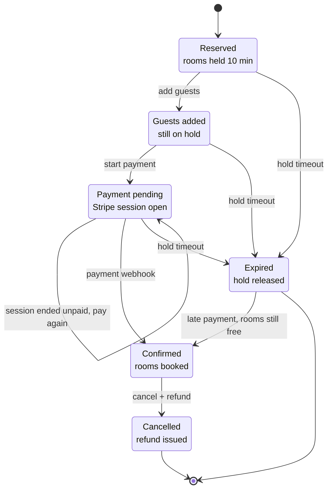

# Hotel Booking Backend: Project Design

Oct 25, 2026 · @Gaurav Gondane

## Overview

This is a hotel booking backend in Java and Spring Boot, built test-first, that focuses on the things real booking systems get wrong: selling the last room twice, charging for a payment that arrives twice, and holds that never release.

The starting point is the public [Amanshakya-code/AirBnb](https://github.com/Amanshakya-code/AirBnb) repo. It covers JWT auth, hotel and room admin, per-room inventory, a booking flow, and a Stripe payment webhook. That same structure shows up in a lot of forks, so this version keeps the domain and goes deeper in three places:

- **Correctness under pressure.** Concurrency-safe inventory, expiring holds, idempotent payments, and an outbox for side effects, each one proven by a test.
- **Redis with real jobs.** Rate limiting, idempotency keys, caching, distributed job locks, and token revocation. Postgres stays the source of truth.
- **Visible TDD.** Every feature starts with a failing test, and the git history shows it.

The result should be a repo you can walk an interviewer through, where every design decision has a test behind it.

## Goals and non-goals

The project wins if it proves backend judgment with tests, not if it has the most endpoints.

**Goals**

- Production-style Spring Boot: clear modules, Flyway migrations, real integration tests against real Postgres and Redis.
- Prove correctness under concurrency with tests, not claims.
- Use Redis only where it earns its place, and be able to explain why each use is there.
- TDD you can see in the commit history.
- One `docker compose up` to run everything, and a green CI run on every push.

**Non-goals**

- No frontend. Swagger UI is the client.
- No microservices. This is a modular monolith, which is the honest choice at this size.
- No real money. Stripe runs in test mode.
- No reviews, messaging, maps, or image uploads. They add surface area without adding hard problems.

## Tech stack

Everything here is mainstream on purpose, so the interesting part is how it's used.

| Layer | Choice | Why |
| --- | --- | --- |
| Language | Java 21 or 25 (LTS) | Records, sealed types for booking states, virtual threads if you want to try them |
| Framework | Spring Boot (current stable), Spring Web, Spring Security | The thing you're here to show |
| Persistence | PostgreSQL, Spring Data JPA, Flyway | Row locks, check constraints, versioned migrations |
| Cache and coordination | Redis, Spring Data Redis (Lettuce), Redisson | Rate limits, idempotency, caching, locks |
| Payments | Stripe Java SDK, test mode | Checkout sessions, signed webhooks, refunds |
| API docs | springdoc-openapi | Swagger UI as the client |
| Mapping | MapStruct | Keeps entities out of API responses |
| Observability | Micrometer, Prometheus, Grafana | Business metrics, not just HTTP latency |
| Testing | JUnit 5, AssertJ, Mockito, Testcontainers | Real databases in tests, no H2 |
| Build and CI | Maven, JaCoCo, GitHub Actions, Docker Compose | Reproducible builds and coverage reports |

## Domain model and schema

The central idea is that inventory is one row per room type per night, and the database itself refuses to oversell.

| Table | Key columns | Notes |
| --- | --- | --- |
| `users` | id, email (unique), password\_hash, role (GUEST, HOTEL\_MANAGER, ADMIN) | Roles drive `/admin` (managers) and `/moderation` (admins) access. ADMIN can't be chosen at signup |
| `hotels` | id, owner\_id, name, city, time\_zone, active, amenities, approval\_status, rejection\_reason | Only active hotels show up in search. Deactivating stops new bookings but keeps history |
| `rooms` | id, hotel\_id, type, base\_price, capacity, total\_count | A room type, not a physical room |
| `inventory` | id, room\_id, date, total\_count, total\_overridden, booked\_count, reserved\_count, surge\_factor, closed | Unique on (room\_id, date). Check constraint: booked\_count + reserved\_count <= total\_count. Nights whose total was set by hand keep it when the room's total changes |
| `bookings` | id, user\_id, room\_id, check\_in, check\_out, rooms\_count, status, amount, hold\_expires\_at, version | Amount is frozen at reservation time |
| `guests` | id, user\_id, name, age, gender | Saved guests a user can reuse |
| `booking_guests` | booking\_id, guest\_id | Join table |
| `payments` | id, booking\_id, provider\_session\_id, checkout\_url, status, amount, currency, payment\_intent\_id, refund\_id, refunded\_amount | One booking can have an expired or failed attempt and a successful one, but at most one open or paid at a time (partial unique index). A cancellation makes a refund due (`REFUND_PENDING`, with its amount); it's `REFUNDED` once made, never for more than was paid |
| `processed_webhook_events` | event\_id (primary key), received\_at | Dedupes Stripe events inside the same transaction as the state change |
| `outbox_events` | id, aggregate\_id, type, payload (jsonb), created\_at, published\_at, attempts, last\_error, failed\_at | Side effects written atomically with the booking; an event that keeps failing is parked after 10 attempts instead of retried forever; a partial index keeps the waiting queue small |
| `hotel_min_price` | hotel\_id, date, min\_price | Precomputed cheapest night, keeps search fast |

Four decisions worth calling out:

- **Holds live in Postgres.** A pending booking increments `reserved_count`. When the hold expires, a job moves it back. Redis never owns this number.
- **The check constraint is the last line of defense.** Even if application logic has a bug, the database rejects an oversell.
- **Prices are copied onto the booking.** If a surge rule changes after someone reserves, they still pay what they were quoted.
- **A night is a local date; a moment is UTC.** Inventory dates, check-in, and check-out are dates in the hotel's own time zone, so "today" for a hotel in Goa starts at midnight in Goa. Instants like `hold_expires_at` are stored in UTC.

## API surface

The endpoints mirror the original repo, plus a few that make the hard parts visible. All routes sit under `/api/v1`.

| Module | Endpoints | Notes |
| --- | --- | --- |
| Auth | `POST /auth/signup`, `POST /auth/login`, `POST /auth/refresh`, `POST /auth/logout` | Login is rate limited. Logout revokes the refresh token. Signup answers 202 the same way for a new or a registered email (the owner of a registered one is emailed instead), so it can't reveal who has an account |
| Browse | `GET /hotels/search`, `GET /hotels/{id}/info` | Search takes city, dates, rooms, and pagination. Cached |
| Hotel admin | CRUD on `/admin/hotels`, `PATCH /admin/hotels/{id}/activate`, `PATCH /admin/hotels/{id}/deactivate` | Activation generates a year of inventory rows, and an hourly job keeps it a year ahead as each hotel's midnight passes. A hotel or room type with bookings can be deactivated but not deleted. Deactivating honours paid bookings (off sale may be a pause); guests can still cancel them under the normal policy |
| Room admin | CRUD on `/admin/hotels/{id}/rooms` | Owner-only |
| Moderation | `GET /moderation/hotels`, `PATCH /moderation/hotels/{id}/approve`, `PATCH /moderation/hotels/{id}/reject` | Admins only. A hotel can't be activated until it's approved |
| Inventory admin | `GET` and `PATCH /admin/inventory/rooms/{roomId}` | Bulk update a date range: close dates, change surge, change totals |
| Booking | `POST /bookings/init`, `POST /bookings/{id}/guests`, `POST /bookings/{id}/payments`, `POST /bookings/{id}/cancel`, `GET /bookings/{id}/status` | `init` and `payments` require an `Idempotency-Key` header |
| User | `GET` and `PATCH /users/profile`, `GET /users/bookings`, CRUD on `/users/guests` |  |
| Reports | `GET /admin/hotels/{id}/bookings`, `GET /admin/hotels/{id}/reports` | Revenue and occupancy over a date range; revenue by night stayed (each paid booking's amount less refunds, spread over its nights) |
| Webhook | `POST /webhook/payment` | Signature verified, no JWT |
| Ops | `/actuator/health`, `/actuator/prometheus` | Not exposed publicly in production |

Errors follow one shape (RFC 9457 problem details), so clients and tests can assert on a stable `type` field instead of message strings.

## Core flows

A booking moves through a strict state machine, and only a verified Stripe webhook can make it Confirmed.



Any state before Confirmed can time out. A Confirmed booking can only end by cancellation with a refund. An Expired booking can still be confirmed by a payment that arrives late (below); if it can't, the payment is refunded and the booking stays Expired.

1. **Init.** `POST /bookings/init` locks the inventory rows for every night in the range, checks availability, increments `reserved_count`, and creates the booking as Reserved with `hold_expires_at` set 10 minutes out. The price is calculated and frozen here.
2. **Add guests.** Attach saved guests, validated against room capacity. The hold clock keeps running.
3. **Start payment.** Create a Stripe checkout session for the frozen amount. The `Idempotency-Key` header means a retried click returns the same session instead of creating a second one.
4. **Webhook.** Verify the Stripe signature, then in one transaction: insert the event id into `processed_webhook_events` (a duplicate fails here and is ignored), move the counts from reserved to booked, mark the booking Confirmed, and write an outbox event. A session that closes unpaid (`checkout.session.expired`) or whose delayed payment fails (`checkout.session.async_payment_failed`) ends its payment; while the rooms are still held, the guest can start a new payment. A delayed payment that goes through (`checkout.session.async_payment_succeeded`) confirms like any other.
5. **Expiry.** A scheduled job runs every minute, takes a Redis lock so only one instance runs it, and releases any holds past `hold_expires_at`. For a hold that was being paid for, it then asks Stripe to close the checkout session.
6. **Cancel.** Decrement `booked_count`, mark the booking Cancelled, record the refund that's due, and write the refund and the guest's email to the outbox, all in one transaction. The outbox makes the refund with one idempotency key and the amount fixed at cancellation, so it happens exactly once even if Stripe is down or the app crashes mid-way. A cancellation policy lives in plain domain code so it's easy to unit test. As decided: a full refund with at least 48 hours' notice before check-in, half with less, and no cancelling once the stay has begun, at 2 PM hotel time on the check-in date. Notice is counted in hours that actually pass, so a clock change doesn't shift it.

One edge case is worth handling on purpose: a webhook that arrives after the hold expired. Stripe keeps a checkout session open for at least 30 minutes, longer than the hold, so a guest can pay after their rooms went back on sale. The expiry job closes the session, but a payment can still get through (made as the session closed, or while Stripe couldn't be reached). The webhook then re-checks the stay as init would: the hotel on sale, the stay not yet begun, every night open with the rooms free. If so, it books the rooms at the price the guest paid and confirms the booking. If not, it refunds in full and the booking stays Expired. The refund is made outside the transaction, so Stripe is never called with inventory locked, and the event is recorded only once the refund succeeds: until then Stripe keeps redelivering it, and one idempotency key per payment means it's refunded once however many deliveries race. More generally, any payment the booking can't take is refunded rather than left stuck. It makes a good test case and a good interview story.

## Hard problems

These four are the reason the project exists. Each gets a test written before the code that solves it.

### Double booking

Two people request the last room at the same moment. Both read "1 available" and both succeed unless something stops them.

- **Approach:** pessimistic locking. `SELECT ... FOR UPDATE` on the inventory rows for the date range, always in date order so two overlapping bookings can't deadlock each other.
- **Why not optimistic:** contention is concentrated exactly on the last few rooms, which is where optimistic locking retries the most. Worth benchmarking both as a stretch goal, though.
- **Safety net:** the check constraint on `inventory` rejects any oversell that slips through.

### Idempotency

Networks retry, users double-click, and Stripe sends webhooks at least once.

- Client retries use an `Idempotency-Key` header stored in Redis with the original response.
- Webhook dedupe uses a Postgres table instead of Redis, because the "already processed" marker has to commit in the same transaction as the state change. If it lived in Redis, a crash between the two writes could lose or double-apply an event.

### Side effects and the outbox

Confirmation emails and notifications shouldn't happen inside the booking transaction, but they also can't get lost. The booking transaction writes a row to `outbox_events`, and a scheduled publisher sends whatever hasn't been published yet. Delivery is at least once, so consumers have to tolerate duplicates. For this project the "consumer" can be a log or a fake email sender.

As built: the writer only runs inside the caller's transaction. The publisher takes `lock:outbox`, then sends each waiting event in its own transaction: it locks the row (`for update skip locked`, so runs that overlap split the queue), hands it to the consumers for its type, and marks it published. If a consumer throws, that transaction rolls back and a second one counts the attempt; after 10 the event is parked with its last error rather than retried forever. The email consumer uses the outbox event's id as the email's idempotency key, as a real provider's would be, so an event delivered twice sends one email. Booking repricing stays on its own after-commit executor: prices must update within milliseconds, and a lost recompute only leaves a stale "from" price. At most one recompute waits per hotel, and later bookings merge into it, so a burst of bookings queues one recompute rather than one each (the load test found the per-booking queue dropping thousands).

### Pricing and search

- **Pricing** is a chain of small rules applied per night: base price, then surge factor, occupancy, weekend, and holiday adjustments. Each rule is a class with its own unit tests, composed with the decorator or strategy pattern.
- **Search** finds hotels in a city where every night in the range has enough rooms available. In SQL that's a `GROUP BY` with `HAVING COUNT(*) = number_of_nights`. The unique index on `inventory (room_id, date)` and the index on `hotels (city, active)` keep it fast (a planned `inventory (date, room_id)` index turned out unused and was dropped; see the query plans), and `hotel_min_price` handles the "from $X a night" listing without scanning inventory. Check the query plans with `EXPLAIN ANALYZE` and put them in the README.

## Redis

Redis makes the system faster and harder to abuse, but Postgres decides what's true. If Redis gets flushed, you lose speed and some protection, never a booking.

| Use | How | Key pattern | TTL | If Redis is down |
| --- | --- | --- | --- | --- |
| Rate limiting | Token bucket in a Lua script, so check and decrement are atomic | `rl:{route}:{user or ip}` | About one window | Fail open and log it. Availability beats strict limits here |
| Idempotency keys | `SET NX` with status and stored response | `idem:{userId}:{key}` | 24 hours | Fail closed with 503. Better than a duplicate payment |
| Caching | Spring Cache with a Redis cache manager | `hotel:{id}`, `search:{city hash}:v{version}:{query}`, `search-version:{city hash}` | Hotel info about 10 minutes, search about 60 seconds | Fall through to Postgres |
| Job locks | `SET NX` with a lease, released by a compare-and-delete Lua script | `lock:hold-expiry`, `lock:outbox`, `lock:inventory-roll` | Lease shorter than the job interval | That run is skipped, the next one catches up |
| Token revocation | Opaque refresh tokens stored as a hash, single use (rotated on refresh), deleted on logout | `refresh:{sha256(token)}` | Token lifetime (7 days) | Refresh fails, users log in again |

Cache invalidation is the subtle part. Hotel details can live in the cache for minutes. Search results depend on availability, so they get a short TTL plus eviction whenever inventory for that hotel changes. Eviction bumps a per-city version that is part of every search key, so it costs one `INCR` instead of a scan for old keys. Write a test for the eviction, since stale availability is the bug users would actually notice.

## Test-driven development

Every feature starts as a failing test that states a business rule in plain words, like "a hold expires after 10 minutes" or "the same webhook twice confirms once."

**The loop:** write the test, watch it fail for the right reason, write the least code that passes, refactor, commit. Most tasks land as one commit with the test and the code together. The signature tests below are the exception: commit the failing test on its own (`test: reject booking when sold out`) and the fix after it (`feat: lock inventory rows on init`). That way the history shows the process for the tests you'll talk about, without doubling every commit.

| Layer | Tools | What it covers | Speed |
| --- | --- | --- | --- |
| Unit | JUnit 5, AssertJ, Mockito | Pricing rules, booking state transitions, cancellation policy, validation | Milliseconds, no Spring |
| Web slice | `@WebMvcTest` | Request validation, auth rules, error shape, status codes | Fast |
| Data slice | `@DataJpaTest` with Testcontainers Postgres | Availability query, constraints, locking queries | Seconds |
| Integration | `@SpringBootTest` with Testcontainers Postgres and Redis | Full flows, concurrency, idempotency, rate limits, caching | Slower, run on every push |
| Webhook | Signed Stripe test payloads | Signature checks, duplicates, out-of-order events | Part of integration |

**Signature tests** (the ones to show in an interview):

- [x] 50 concurrent requests for the last room: exactly one succeeds, 49 get a clean "sold out" error
- [x] A hold expires after 10 minutes using an injected `Clock`, with no `Thread.sleep`
- [x] The same webhook delivered twice confirms the booking once and creates one outbox row
- [x] A webhook that arrives after the hold expired gets confirmed or refunded, never stuck
- [x] A retried `POST /bookings/init` with the same `Idempotency-Key` returns the original booking
- [x] The 11th login attempt inside the window is rejected with 429
- [x] Changing inventory evicts the cached search result for that hotel
- [x] Cancelling restores inventory and calls the refund exactly once

**Habits that keep the suite trustworthy:**

- Inject `Clock` everywhere instead of calling `now()`. Time-based tests become instant and deterministic.
- Reuse one Postgres and one Redis container across the whole suite, so tests stay fast.
- Don't put `@Transactional` on concurrency tests. It hides the very races you're trying to catch.
- Use test data builders (`aBooking().forNights(3).build()`) so each test only states what matters to it.
- JaCoCo reports coverage on every run. Treat the number as a signal, and aim for high coverage on the domain package rather than a project-wide target.

## Project structure, ops, and CI

Package by feature, so each module owns its controller, service, domain, and repository, and the boundaries stay visible.

```
src/main/java/.../booking
  auth/         signup, login, JWT, refresh tokens
  hotel/        hotels, rooms, activation
  inventory/    per-night inventory, admin updates
  search/       availability query, min-price table
  pricing/      pricing rules and the rule chain
  booking/      lifecycle, holds, expiry job
  payment/      Stripe client, webhook, refunds
  outbox/       outbox writer and publisher
  common/       errors, idempotency, rate limiting, clock
src/main/resources/db/migration   Flyway scripts (V1__init.sql, ...)
```

**Local setup:** `docker compose up` starts the app, Postgres, Redis, Prometheus, and Grafana. Spring profiles split `local`, `test`, and `prod` config, and secrets like the Stripe key come from environment variables only.

**CI (GitHub Actions on every push and PR):**

1. Build and run unit tests
2. Run integration tests with Testcontainers (Docker is available on GitHub-hosted runners)
3. Publish the JaCoCo report
4. Build the Docker image

**Metrics worth exposing**, beyond default HTTP latency: bookings created, holds expired, duplicate webhooks ignored, rate-limit rejections, and cache hit ratio. A Grafana screenshot in the README shows you think about running the system, not just writing it.

**Deployment** is optional. A free tier on Render, Railway, or Fly with managed Postgres and Redis is enough for a live Swagger link.

## Build plan

The plan assumes about 8 weeks of evenings. Each week ends with a green CI run and a demo-able slice, so stopping early still leaves something solid.

| Week | Focus | Tests written first | Done when |
| --- | --- | --- | --- |
| 1 | Skeleton: project setup, Compose, Flyway, Testcontainers base, CI | App starts against real Postgres and Redis | CI is green on an empty app |
| 2 | Auth: signup, login, JWT, refresh tokens in Redis, login rate limit | Bad password gets 401, wrong role gets 403, 11th login gets 429, logout kills the refresh token | Swagger can log in and call a protected route |
| 3 | Hotels, rooms, inventory admin | Non-owner gets 403, activation creates a year of inventory rows | A manager can set up a hotel end to end |
| 4 | Pricing and search, plus caching | One unit test per pricing rule, search skips a hotel with one sold-out night, cache evicts on inventory change | Search returns correct hotels and prices |
| 5 | Booking init, holds, expiry job | 50-thread last-room test, hold expiry with a fixed clock, only one instance runs the job | No oversell under load |
| 6 | Payments: Stripe sessions, idempotency keys, webhook | Duplicate webhook, late webhook after expiry, retried payment returns the same session | A test-card payment confirms a booking |
| 7 | Cancellations, refunds, outbox, reports | Cancel restores inventory, refund called once, outbox row written in the same transaction | Full lifecycle works, including the unhappy paths |
| 8 | Hardening: metrics, load test, README, optional deploy | Load test with k6 or Gatling against the booking endpoint | README explains every design decision with links to its tests |

The README is part of the deliverable. Give each hard problem a short section: what can go wrong, what you chose, what you rejected, and which test proves it.

## Dev workflow with Claude Code

Keep each coding session small and well-scoped, and let tooling handle code discovery so tokens go into writing code, not re-reading it.

### LeanToken for code discovery

[LeanToken](https://github.com/morluto/leantoken) is a local, read-only MCP server that gives Claude ranked search, outlines, and exact line ranges instead of whole-file reads.

- **Setup:** run `npx leantoken setup`, restart Claude Code, then run `npx leantoken doctor` from the repo.
- **When it helps:** from around week 4 or 5, once the codebase has enough services and tests that exploring it gets expensive. Expect little benefit in weeks 1 and 2.
- **How to use it:** one `context` call at the start of a task, plus at most one follow-up search. Long chains of back-and-forth calls can cost more tokens than they save.
- **Check it's working:** confirm it indexes the Java files, and run `npx leantoken savings` now and then to see real numbers.

### CLAUDE.md

A short file at the repo root so Claude doesn't rediscover conventions every session. Keep it under a page.

```markdown
# Hotel booking backend

## Workflow
- TDD: write the failing test first, commit it, then the code that passes it.
- Commit messages: `test: ...` for failing tests, `feat:` / `fix:` / `refactor:` for code.
- Run `./mvnw verify` before saying a task is done.

## Layout
- Package by feature: auth, hotel, inventory, search, pricing, booking, payment, outbox, common.
- Migrations in src/main/resources/db/migration (Flyway). Never edit an applied migration.

## Rules
- Postgres is the source of truth for inventory and bookings. Redis is for speed and protection only.
- Inject `Clock`; never call `now()` directly.
- Integration tests use Testcontainers. No H2.
- No `@Transactional` on concurrency tests.
- Use LeanToken tools for finding code before reading whole files.
```

### Session habits

- **One feature per session.** Start from a failing test or a single row of the build plan, finish it, commit, then clear the context.
- **Hand off between sessions.** End each session with a short handoff note (what's done, what's next, open questions) and start the next one from that note instead of re-exploring the repo.
- **Point, don't paste.** Name the file or test that matters (`InventoryLockingIT`) rather than pasting large chunks of code into the chat.
- **Let tests carry the context.** A failing test with a clear name tells Claude exactly what to build, which keeps prompts short.

## Interview stories and stretch goals

The project should hand you four stories you can tell in two minutes each, with the test as proof.

1. **"How I stopped double booking."** The race, the lock choice, lock ordering to avoid deadlocks, the check constraint, and the 50-thread test.
2. **"Exactly-once effects from at-least-once delivery."** Why webhook dedupe lives in Postgres and client idempotency lives in Redis, plus the outbox.
3. **"What Redis owns and what it doesn't."** Each use, its failure mode, and why inventory never lives there.
4. **"Testing time and concurrency."** The injected clock, real containers, and why `@Transactional` hides races in tests.

**Stretch goals,** in rough order of payoff:

- Benchmark pessimistic against optimistic locking under contention and publish the numbers
- Mutation testing with PIT on the domain package
- Publish outbox events to Redis Streams or Kafka instead of polling
- A waitlist that offers a released hold to the next person in line
- Virtual threads with a before-and-after load test
